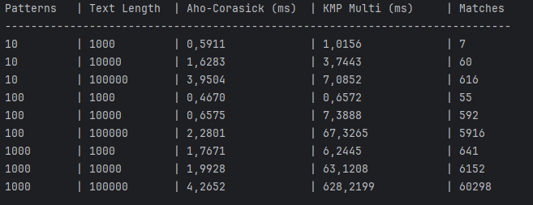

# DAA-Aho-Corasick

## Report

### How Aho–Corasick Works

The Aho–Corasick algorithm is a string-searching algorithm designed to locate all occurrences of multiple patterns simultaneously in a single pass through the text. 
Instead of scanning the text repeatedly for every pattern, the algorithm combines all patterns into a finite-state automaton built on top of a prefix tree (Trie).

#### 1. Trie Construction
First, all target patterns are inserted into a Trie starting from a shared root node. Each edge represents a character, and each path from the root to 
a node represents a prefix of one or more patterns. If two patterns share a common prefix (for example, `"he"` and `"hers"`), they share the same path in the tree 
until their characters diverge. The nodes where a full pattern ends are marked as output states storing the matched pattern.

#### 2. Failure Links Construction
To avoid backtracking in the text when a character mismatch occurs, the algorithm builds failure links using Breadth-First Search (BFS) level by level:
- For the root and all nodes at depth 1, the failure link points directly back to the root.
- For any deeper node `u` reached from parent `v` via character `c`, the algorithm follows `v`'s failure link (`f = v.fail`) until it finds a node that also has an outgoing edge labeled `c`, or until it reaches the root.
- If such a node exists, `u.fail` points to `f.next(c)`; otherwise, `u.fail` points to the root.

Mechanically, a failure link points to the longest proper suffix of the current string that is also a valid prefix in the Trie. Additionally, 
output lists are merged along failure links (`u.out.addAll(u.fail.out)`), which acts as output links and ensures that shorter patterns embedded 
as suffixes inside longer patterns (such as `"she"` and `"he"`) are never missed.

#### 3. Searching Multiple Patterns
During the search phase, the algorithm reads the input text character by character, maintaining a current state starting at the root:
- If the current node has a transition for the next character in the text, the automaton simply moves to that child node.
- If there is no matching transition, the automaton follows failure links until a valid transition is found or it returns to the root.
- At every visited state, if the node's output list is non-empty, all patterns stored in that list are recorded along with their starting indices (`currentIndex - pattern.length() + 1`).

Because the text pointer only moves forward and never resets, all patterns are detected in a single linear scan.

---

### Theoretical complexity

Let $N$ be the length of the text, $M$ be the total length of all patterns combined, $K$ be the number of patterns, and $Z$ be the total number of matches found.

#### Aho–Corasick
Time complexity is $O(N + M + Z)$, $\Theta(N + M + Z)$ and $\Omega(N + M)$. Space complexity is $O(M)$ (using `HashMap` per node, or $O(M \cdot |\Sigma|)$ with 
fixed arrays). In worst case, if patterns heavily overlap as nested prefixes and suffixes (e.g., `"a"`, `"aa"`, `"aaa"`), storing copied output lists 
can take up to $O(M\sqrt{M})$ space, while search still runs in linear time relative to text and output size.

- Trie Construction: Inserts every character of every pattern once, taking $O(M)$ time in average with `HashMap` transitions.
- Failure Links (BFS): Visits each node in the Trie once. Although there is an inner `while` loop traversing failure links, the total number of pointer jumps across the entire build phase cannot exceed the total depth of the Trie, keeping construction time at $O(M)$.
- Search: Reads each character of the text once ($O(N)$) and outputs all found occurrences ($O(Z)$), resulting in $O(N + Z)$ total search time independent of $K$.

#### KMP (Multi-pattern baseline)
Running KMP separately for $K$ patterns has time complexity $O(K \cdot N + M + Z)$ and space complexity $O(\max |P_i|)$.

- Preprocessing (LPS array): Computes the longest proper prefix-suffix table for each pattern in $O(M)$ total time.
- Search: Scans the entire text of length $N$ from scratch for every single pattern, requiring $K$ full passes over the text.

---

### Result

### Performance analyze
Result confirms the theoretical complexity: As the number of patterns $K$ grows from 10 to 1,000, Aho–Corasick scales significantly better than 
running KMP multiple times. At $K = 1000$ and text length $100,000$, Aho–Corasick is roughly 35–40 times faster because it processes 
the text in a single pass ($O(N + M + Z)$), whereas KMP rescans the 100,000-character string 1,000 times ($O(K \cdot N + M)$).
However, for small inputs ($K = 10$, text length $= 1,000$), KMP shows slightly faster or nearly identical execution time. This is explained 
by the construction overhead in Aho–Corasick: allocating Trie nodes, creating `HashMap` instances, and running BFS takes extra time and triggers 
garbage collection compared to KMP's simple primitive `int[]` array. Additionally, the first test iterations are slightly slower 
due to the JVM warm-up effect (JIT compilation) and class loading.

### Conclusion
Aho–Corasick is vastly superior to repeated KMP for multi-pattern matching on large texts and large dictionaries due to its single-pass $O(N + M + Z)$ search guarantee. Its main limitation is higher memory consumption and automaton build overhead, making standard KMP a better and lighter choice when searching for only a few patterns or working under strict memory constraints.